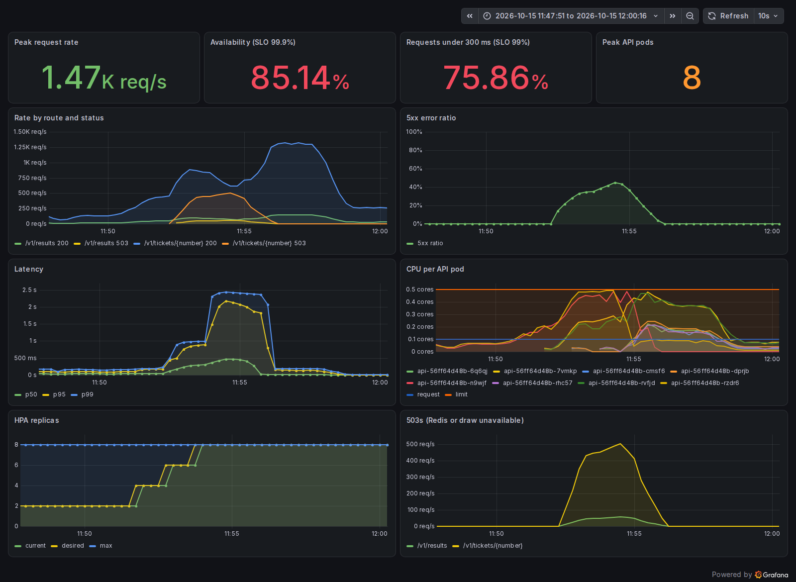
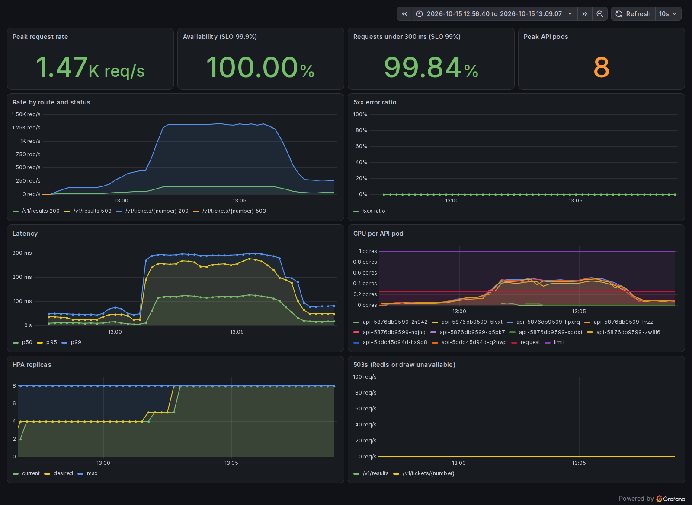
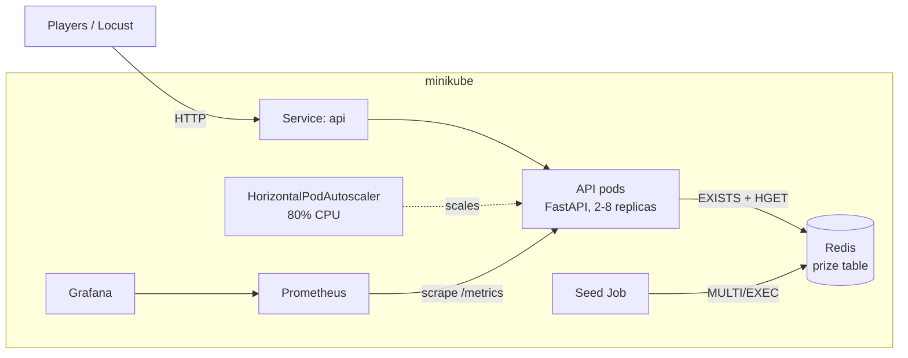
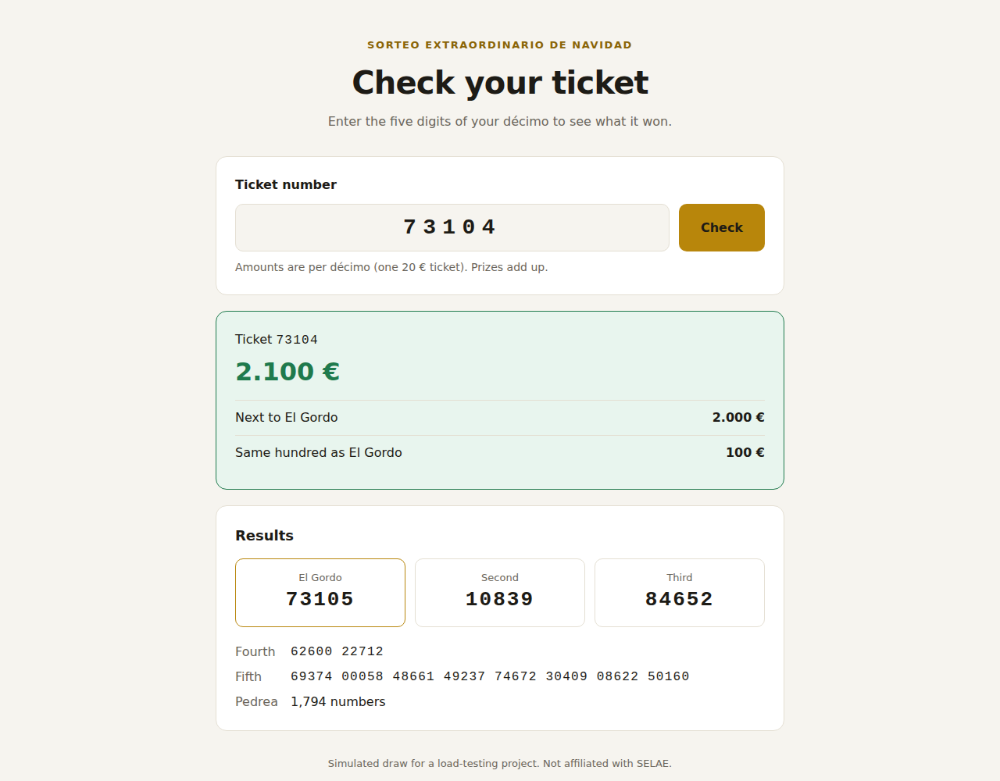

# Navidad Spike: Load-Testing a Lottery Results API on Kubernetes

[](https://github.com/mohamedaly-cloud/navidad-spike/actions/workflows/ci.yml)

A lottery results API on Kubernetes, load-tested against a simulated draw morning.


## The Story Behind the Project

This is the third and last part of my lottery series.

For **[El Gordo 2025](https://github.com/mohamedaly-cloud/el-gordo-lottery-aws)** I built a checker for my friends and promised "No Crashes". I said it would scale "if 10 or 10,000 people use it". Honestly, I never tested that.

For **[El Niño 2026](https://github.com/mohamedaly-cloud/el-nino-lottery-aws)** I built my own backend with Lambda, DynamoDB and Terraform.

After that I started learning Kubernetes, and I wanted to answer the question I skipped: what happens when everyone checks their ticket at the same time?

So I built a results API on Kubernetes, simulated a draw morning, and tried to break it. The first run failed badly, with 15% of requests getting errors. It took me four runs to fix it.

What surprised me most was the autoscaler. It added new pods, but they got no traffic at all. Clients keep their connections open, and a Kubernetes Service balances connections, not requests. It's a known problem, but I only really understood it once I saw it on my own dashboard.

Everything runs on my laptop with minikube, so I could break it as many times as I wanted, for free.

This is the kind of work I want to do every day.

## Key Results

A simulated draw morning at 1:10 scale: 150 req/s before the draw, a jump to **1,500 req/s in 10 seconds** when El Gordo is announced, four minutes at the peak, then the decay.

| Run | What changed | Availability (target 99.9%) | Under 300 ms (target 99%) | Failed requests |
| :--- | :--- | :--- | :--- | :--- |
| 1 | Baseline | 85.14% | 75.86% | 86,285 |
| 2 | Redis connection pool waits, probe timeouts relaxed | 99.82% | 74.23% | 1,095 |
| 3 | Pre-scaled to 4 pods before the draw | 100% | 96.78% | 0 |
| 4 | CPU request and limit sized from measurements | **100%** | **99.84%** | **0** |

**Before (run 1):** errors climb to 45% as soon as the spike hits.



**After (run 4):** the same spike, no errors, p99 under 300 ms.



## What Broke, and What I Learned

Each one is in the [load test report](docs/load-test-report.md) with the evidence.

1. **The Redis client gave up instead of waiting.** When pods got busy, they ran out of Redis connections and the client failed right away. Redis itself was almost idle. Around 32,000 of the 86,000 errors came from this one default setting.
2. **Kubernetes restarted my busiest pods.** The liveness probe had a 1-second timeout. The pods were slow under load, not dead, but Kubernetes restarted them in the middle of the spike anyway.
3. **New pods got no traffic.** See above. Pre-scaling before the draw fixes it here. In production you'd need a layer 7 load balancer.
4. **CPU limits slowed pods down before they were full.** Pods using 60–70% of their limit were still throttled in up to half of the 100 ms periods, and that showed up as latency.

I also ran three failure drills. Killing a pod or doing a rolling update under load caused zero failed requests. Losing Redis caused 32 seconds of errors, until the data was loaded again. At real draw-day traffic, that's about six times the day's error budget, so it's the first thing I'd fix.

## Architecture



The prize table is calculated once when the draw is published and stored in a Redis hash, so checking a ticket is one lookup, whatever the number. The API reports its own request rate, errors and latency, and the dashboard shows them against the SLO targets.

## Technology Stack

| Component | Tool | Details |
| :--- | :--- | :--- |
| **API** | Python 3.12, FastAPI | `/v1/tickets/{number}`, `/v1/results`, liveness and readiness probes, a small ticket checker page |
| **Data** | Redis 8 | Precomputed prize table (14,038 winning numbers), written in one transaction |
| **Platform** | Kubernetes (minikube) | Rolling updates with zero downtime, HPA from 2 to 8 pods |
| **Observability** | Prometheus, Grafana | RED metrics from the app, a dashboard with the SLIs, provisioned from the repo |
| **Load testing** | Locust | A draw-morning load shape and failure drills |
| **CI** | GitHub Actions | Lint, tests, image build and a smoke test on every push |

## Demo



*The ticket checker served by the API. It also handles "results not published yet" and a busy service with a clear message.*

## Documents

- [SLOs](docs/slos.md): what "working" means for players, the error budget and the draw-day policy.
- [Capacity estimate](docs/capacity.md): from 30 million players to requests per second and pods.
- [Load test report](docs/load-test-report.md): the four runs, the findings, the failure drills and the remaining risks.

## Run It Yourself

You need Docker, minikube, kubectl, Helm and Python 3.12.

```bash
# Cluster with the API's NodePort published to localhost
minikube start --driver=docker --cpus=6 --memory=8g --ports=30080:30080
minikube addons enable metrics-server

# Build the image and load it into minikube
docker build -t navidad-api:0.5 .
minikube image load navidad-api:0.5

# Redis, publish the draw, then the API and its autoscaler
kubectl apply -f k8s/redis.yaml
kubectl rollout status deploy/redis
kubectl apply -f k8s/seed-job.yaml
kubectl wait --for=condition=complete job/seed --timeout=120s
kubectl apply -f k8s/api.yaml -f k8s/hpa.yaml

# Open http://localhost:30080
```

Monitoring:

```bash
helm repo add prometheus-community https://prometheus-community.github.io/helm-charts
helm install monitoring prometheus-community/kube-prometheus-stack --version 91.8.2 \
  -n monitoring --create-namespace -f k8s/monitoring/values.yaml
kubectl apply -k k8s/monitoring
kubectl -n monitoring port-forward svc/monitoring-grafana 3000:80   # dashboard "Navidad API"
```

Load test:

```bash
python -m venv .venv && .venv/bin/pip install -r requirements-dev.txt
kubectl patch hpa api -p '{"spec":{"minReplicas":4}}'   # pre-scale, as on draw day
.venv/bin/locust -f loadtest/locustfile.py --host http://localhost:30080 --headless --processes 4
kubectl apply -f k8s/hpa.yaml                           # back to normal
```

## What I'd Do Next

- **Make Redis survive.** Replication with automatic failover, persistence, and an automatic re-seed when the API reports that no draw is published.
- **Balance requests, not connections.** An Ingress controller (or an ALB on AWS) so new pods take traffic as soon as they're ready.
- **Alert on burn rate.** Fast and slow burn alerts on the error budget, so a bad morning pages someone in minutes.
- **Schedule the pre-scaling.** Raise the minimum number of pods before 08:00 on 22 December and lower it after 17:00, instead of doing it by hand.

---

## Author

**Mohamed Aly**
*Junior Site Reliability & Cloud Engineer | AWS Certified Solutions Architect – Associate (SAA-C03)*

Built with focused intent in Barcelona, Spain.
[LinkedIn](https://www.linkedin.com/in/mohamed-aly-cloud/) | [GitHub](https://github.com/mohamedaly-cloud)
