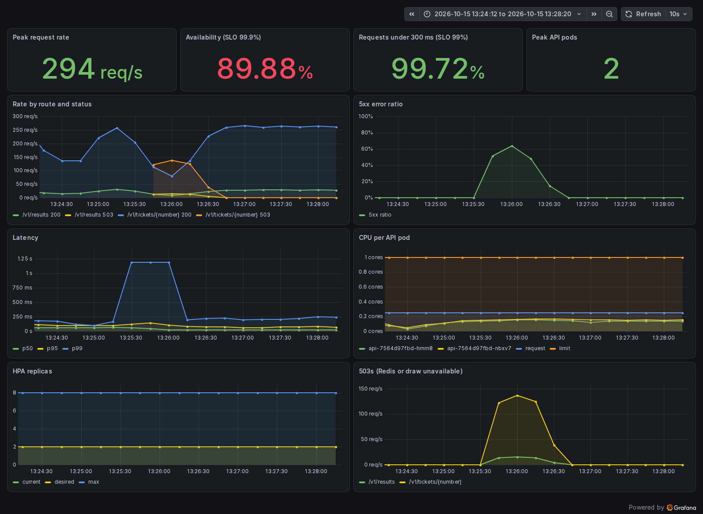

# Load test and failure drills: Navidad results API

A simulated draw morning at 1:10 scale (1,500 req/s, see `docs/capacity.md`), run four times. Each run fixed what the previous one exposed. The first run failed both SLOs; the fourth met both, including during the peak.

## Summary

| Run | Change | Availability (SLO 99.9%) | Under 300 ms (SLO 99%) | 5xx |
|---|---|---|---|---|
| 1 | Baseline | 85.14% | 75.86% | 86,285 |
| 2 | Blocking Redis pool, probe timeouts | 99.82% | 74.23% | 1,095 |
| 3 | Pre-scaled to 4 pods | 100% | 96.78% | 0 |
| 4 | CPU request 250m, limit 1 CPU | **100%** | **99.84%** | **0** |

Over the four peak minutes alone, run 4 kept 100% availability and 99.72% of requests under 300 ms.

**Run 1, baseline:** errors and latency climb as soon as the spike hits, and recover only after the HPA reaches eight pods.


**Run 4, all fixes:** the same spike with no errors and p99 under 300 ms.


## Setup

| | |
|---|---|
| Cluster | minikube, one node (Docker driver, WSL2), Kubernetes 1.37 |
| API | 2–8 pods (HPA at 80% CPU), Redis 1 pod |
| Load | Locust 2.46, 4 processes on the same laptop, 1 req/s per user, 90% ticket checks with random numbers, 10% `/v1/results` |
| Measurement | SLIs from the API's own Prometheus metrics (server side), as defined in `docs/slos.md`. Locust's client-side numbers are kept in `loadtest/results/`. |

Load shape (`loadtest/locustfile.py`), 12 minutes:

| Time | Users (= req/s) | Phase |
|---|---|---|
| 0–2 min | 150 | Before the draw |
| 2–4 min | 500 | Build-up |
| 4–5 min | 1,500 (spawned in 10 s) | El Gordo is announced |
| 5–9 min | 1,500 | Sustained peak |
| 9–12 min | 300 | Decay |

Limitations: the load generator shares the laptop's CPUs with the cluster, traffic enters through Docker Desktop's published port, and the node is not CPU-capped (see `docs/capacity.md`). Absolute numbers are specific to this machine; the failure modes are not.

## Findings

### 1. The Redis connection pool failed fast under queueing

**Run 1.** The spike reached two pods with a combined ceiling of ~1,290 req/s. Requests queued, each pod exceeded 100 requests in flight, and redis-py's default async pool (`max_connections=100`) raised `Too many connections` immediately. About 32,000 requests in the surviving logs failed this way, so the API returned 503 while Redis itself used 0.08 CPU.

**Fix:** a `BlockingConnectionPool` (50 connections, 2 s wait). Requests now wait briefly for a connection instead of failing.

### 2. The liveness probe restarted busy pods

**Run 1.** The probes used the default 1 s timeout. Under load, `/healthz` took longer than that, so the kubelet restarted two pods in the middle of the spike, removing capacity exactly when it was needed, and readiness failures took further pods out of the Service.

**Fix:** `timeoutSeconds: 3` for liveness and 2 for readiness. A busy pod is not a dead one.

**Result of 1 + 2 (run 2):** availability 85.1% → 99.8%, no restarts.

### 3. Pods added by the HPA received no traffic

**Run 2.** The HPA reached 8 pods, but at peak four of them served 0 req/s while two ran at their CPU limit:

| Pods | Load each |
|---|---|
| 2 | ~460 req/s, CPU at the 500m limit |
| 2 | ~240 req/s |
| 4 | 0 req/s |

Locust, like browsers and CDN origins, reuses keep-alive connections, and a Kubernetes Service balances per connection, not per request. All connections were opened while only four pods were ready, and nothing moved them afterwards. Scaling out did not add capacity for existing clients. (In run 1 this was hidden: the restarts from finding 2 broke connections and spread them again.)

**Mitigation here:** pre-scale before the spike (run 3), which is already the error budget policy in `docs/slos.md`. **Production fix:** an L7 load balancer (an Ingress controller, or an ALB) that balances each request across all ready pods.

### 4. CPU limits throttled pods well below the limit

**Run 3.** Pre-scaled to four pods, each served ~300–330 req/s at an average of 0.30–0.36 CPU, under its 500m limit, yet was throttled in 27–50% of CFS periods. The limit is enforced per 100 ms period: a burst that uses the quota early stalls every request in flight until the next period. Availability was 100%, but only 96.8% of requests finished under 300 ms.

**Fix:** CPU request 100m → 250m (closer to measured use, which also makes the HPA target meaningful) and limit 500m → 1 CPU. Throttling fell to 5–19% (run 4).

## HPA behaviour

| Run | Min pods | Reached 8 pods | Notes |
|---|---|---|---|
| 1 | 2 | ~2 min after the spike | Two pods restarted on the way |
| 2 | 2 | ~2 min after the spike | Four new pods idle (finding 3) |
| 3 | 4 | ~1.5 min after the spike | |
| 4 | 4 | ~2 min after the spike | |

The HPA needs 1.5–2 minutes to react to a jump that takes 10 seconds. For a known event, scheduled pre-scaling is the reliable tool and the HPA is the safety net.

## Failure drills

Each drill ran under a steady 300 req/s for 4 minutes, with the action at the 1-minute mark (`loadtest/drills.sh`). Failures are counted by Locust, so they are what clients saw.

| Drill | Action | Failed requests | Recovery |
|---|---|---|---|
| Pod loss | `kubectl delete pod --grace-period=0 --force` on one of two API pods | 0 of 71,250 | Replacement pod Ready without client impact |
| Rolling update | `kubectl rollout restart deploy/api` | 0 of 71,250 | Rollout completed in 13 s |
| Redis loss | Delete the Redis pod, re-seed 30 s later | 9,497 of 71,250 (all 503) | 32 s, ending when the seed Job finished |

**Pod loss.** The force-delete removed the pod from the API at once, but the kubelet still stopped the container through the preStop hook, so this is a fast eviction rather than a hard crash. The preStop sleep plus `maxUnavailable: 0` covered it.

**Rolling update.** No failures: the preStop sleep keeps a terminating pod serving until the Service stops routing to it.

**Redis loss.** Redis has no persistence, so the replacement pod started within a second, but empty. Every request returned 503 ("results not published yet") until the seed Job ran. Two details:

- The 503s stopped as soon as the seed Job wrote the data, with no API restarts. Readiness had taken both pods out of the Service and put them back within ~10 s of the seed.
- Clients kept getting 503s rather than connection errors, because their keep-alive connections stayed on pods that readiness had already removed from the Service (finding 3).



The outage lasted exactly as long as the time to re-seed. In this drill the re-seed was scripted at 30 s; a human response would take minutes. At production peak (15,000 req/s), 32 s of 503s is ~480,000 failed requests, about six times the draw day's whole error budget (0.1% of ~75M checks). **Fixes:** Redis replication with automatic failover (for example ElastiCache Multi-AZ) so that a node loss keeps the data, AOF persistence, and an automated re-seed when `/readyz` reports "no draw published".

## Remaining risks

- **Thin latency margin.** At peak in run 4, p99 was ~290 ms against a 300 ms target, because the four pre-scaled pods still carried all connections (finding 3). An L7 load balancer would spread load across all eight pods.
- **Redis is a single pod.** See the Redis drill. Production needs replication with automatic failover (for example ElastiCache Multi-AZ) and an automated re-seed.
- **Pre-scaling is manual.** On draw day it would run as a scheduled change (`kubectl patch hpa api -p '{"spec":{"minReplicas":N}}'` before 08:00, reverted after 17:00), sized from `docs/capacity.md`.

## Reproduce

```bash
# Draw morning (pre-scaled, as in runs 3 and 4)
kubectl patch hpa api -p '{"spec":{"minReplicas":4}}'
.venv/bin/locust -f loadtest/locustfile.py --host http://localhost:30080 \
    --headless --processes 4 --csv loadtest/results/run
kubectl apply -f k8s/hpa.yaml

# Failure drills
loadtest/drills.sh pod-kill
loadtest/drills.sh rollout
loadtest/drills.sh redis-loss
```
